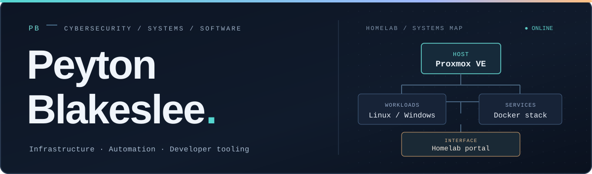
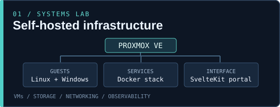
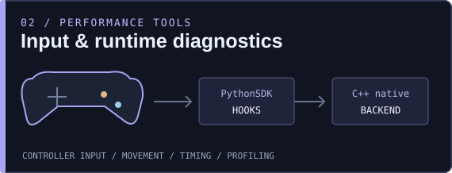

  

  
  

  <strong>Network &amp; Computer Security graduate</strong> &nbsp;•&nbsp; self-hosted infrastructure, debugging, automation, and software development

---

### A little about me

I like getting into the details of how systems work, from virtual machines and networking to low-level input processing in games. Much of my time is spent **building things, finding bottlenecks, and making them more reliable**.

My background is in network and computer security. Outside of that, I work on a Proxmox homelab, self-hosted applications, performance tooling, and software/game development projects.

### What I'm building

<table>
<tr>
<td width="50%" valign="top">
  
  <h3>Homelab &amp; infrastructure</h3>
  
Virtualized Linux and Windows workloads, Docker services, monitoring, networking, and a SvelteKit portal for managing my self-hosted environment.

  
<code>Proxmox VE</code> <code>Docker</code> <code>Linux</code> <code>SvelteKit</code>

</td>
<td width="50%" valign="top">
  
  <h3>Modding &amp; developer tooling</h3>
  
Borderlands 2 PythonSDK mods and diagnostic tools, particularly controller input, movement, runtime hooks, and native C++ performance paths.

  
<code>Python</code> <code>C++</code> <code>Unreal Engine 3</code> <code>GitHub Actions</code>

</td>
</tr>
</table>

I also experiment with **Unity and C# game prototypes**, plus smaller scripts and utilities that solve problems in my day-to-day setup. Some projects are private while they're being developed and prepared for release.

### Technologies I work with

**Languages &amp; scripting**

  

**Platforms &amp; tooling**

  

`Proxmox VE` &nbsp; `Networking` &nbsp; `Self-hosting` &nbsp; `Virtualization` &nbsp; `Performance profiling`

---

### Elsewhere

**[Nexus Mods](https://www.nexusmods.com/profile/PeytonTB)** — game-mod author profile. More public project repositories and release links will appear as they become available.

<!--
LINKS TO FINISH — update the visible social row when you provide real URLs:
- LinkedIn: https://www.linkedin.com/in/ACTUAL-SLUG/
- Public résumé PDF: ./assets/Peyton-Blakeslee-Resume.pdf
- Personal portfolio (optional): https://YOUR-REAL-PORTFOLIO/
- Contact: use an approved public address only.
Never publish the résumé link until the PDF actually exists and has been reviewed.
-->
