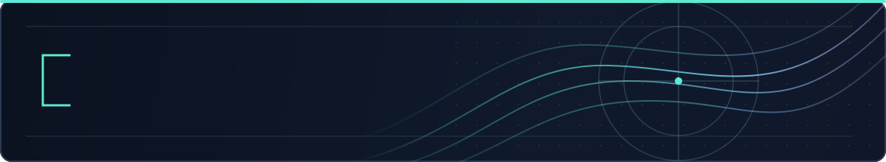

  

<h1 align="center">Peyton Blakeslee</h1>

  <strong>Cybersecurity · Infrastructure · Software Development</strong>

  Building, debugging, and improving systems — from self-hosted infrastructure to developer tools and game mods.

  
  
  
  

---

### About

I'm a network and computer security graduate with an interest in how systems behave underneath the surface. I spend a lot of time working with virtual machines, networking, automation, and performance diagnostics — and building software to solve problems I run into.

### Focus areas

<table>
<tr>
<td width="33%" valign="top" align="center">
  
   
  <strong>Homelab &amp; infrastructure</strong>
    
  Proxmox, Linux and Windows guests, Docker services, networking, monitoring, and a SvelteKit portal for managing my self-hosted environment.
</td>
<td width="33%" valign="top" align="center">
  
   
  <strong>Tooling &amp; automation</strong>
    
  Python, C++, PowerShell, and Bash utilities for diagnostics, workflow automation, troubleshooting, and performance-focused development.
</td>
<td width="33%" valign="top" align="center">
  
   
  <strong>Modding &amp; experiments</strong>
    
  Borderlands 2 PythonSDK mods, native extensions, input systems, and Unity/C# prototypes. Some repositories stay private until release-ready.
</td>
</tr>
</table>

### Languages & tools

  

`Proxmox VE` · `Virtualization` · `Networking` · `Self-hosting` · `Profiling` · `Debugging`

---

### Elsewhere

- **[Nexus Mods — PeytonTB](https://www.nexusmods.com/profile/PeytonTB)** — releases and public mod pages
- **LinkedIn:** link to be added
- **Résumé:** public PDF to be added after review
- **Portfolio:** optional future website

<!--
Follow-up when real public destinations are ready:
- Replace the LinkedIn placeholder badge with a linked badge to the actual profile.
- Upload an approved, public resume PDF and link its repository path in the top badge row.
- Add 2–3 released public projects, if desired.
- Keep private repositories private until explicitly approved for public release.
-->
